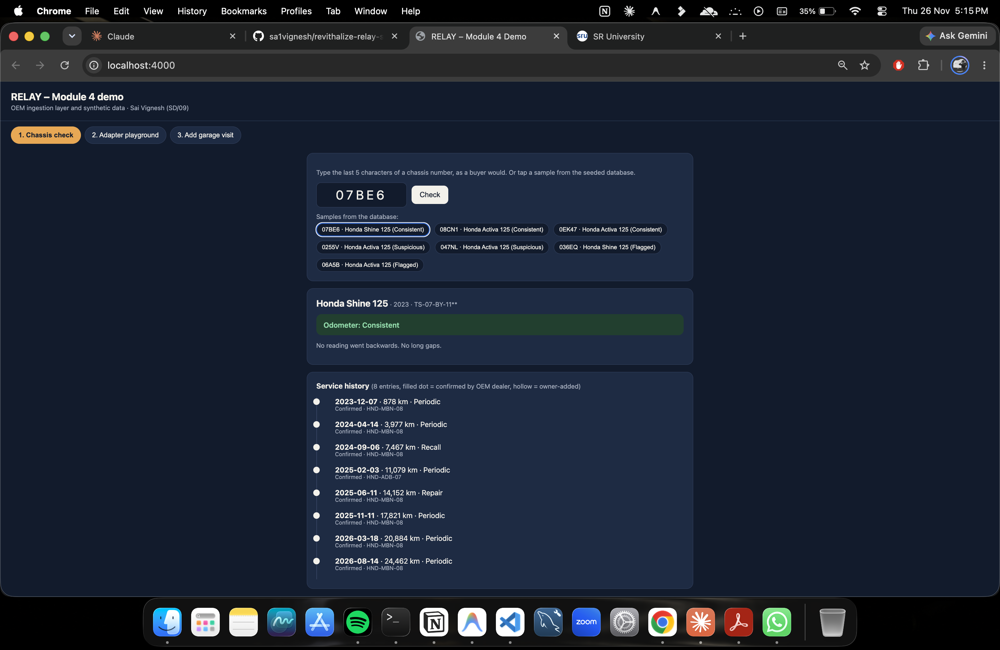
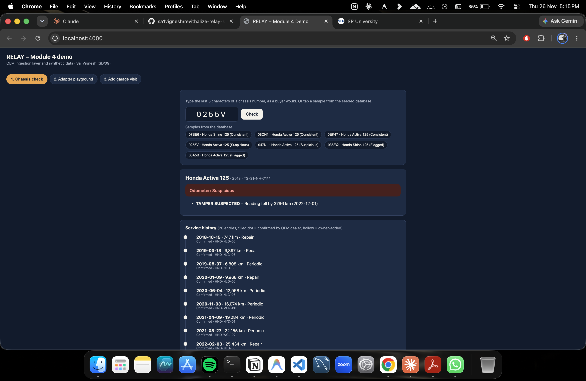
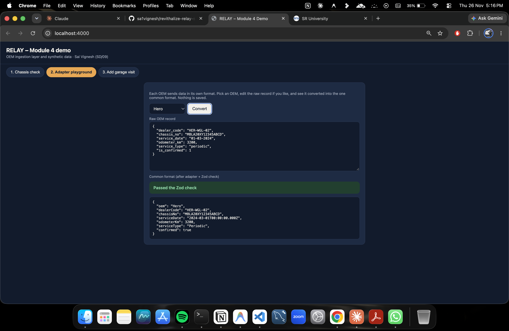
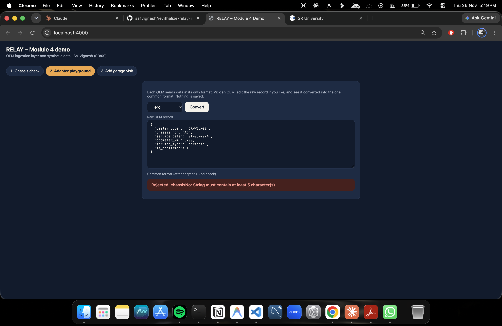
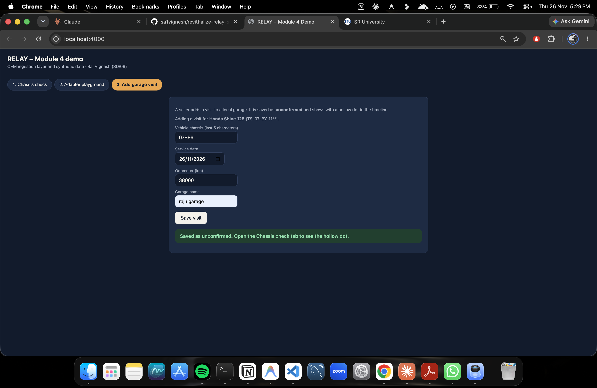

# RELAY – Module 4: OEM Ingestion Layer & Synthetic Data

**Revithalize Mobility – RELAY Sprint** (Ref: RMPL/RELAY/SPRINT/NOV/2026/01)
**Module SD/09** · Built by Sai Vignesh

RELAY is a verified vehicle-history product for used two-wheelers. A seller shares a signed service record, and a buyer checks it by typing the last 5 characters of the chassis number. This module is the data pipeline behind it: it turns the different formats of five OEMs into one common record, and it generates realistic data for the whole team to build and test on.

## Demo

Run the interface with `npm run demo:nodb` (no database needed), then open http://localhost:4000.

### Chassis check

Type the last 5 characters of a chassis number. The page shows the vehicle, an odometer banner and the service timeline. Gaps between visits are always shown, never hidden.

| Clean history                                           | Odometer problem found                                             |
| ------------------------------------------------------- | ------------------------------------------------------------------ |
|  |  |


### Adapter playground

Each OEM sends data in its own format. The playground converts a raw record into the one common format and shows when the Zod check rejects bad data. Nothing is saved.

| Converted                                                         | Rejected                                                |
| ----------------------------------------------------------------- | ------------------------------------------------------- |
|  |  |

### Owner-added garage visit

A seller can add a visit to a local garage. It is stored as **unconfirmed** and shown with a hollow dot, so it is never mistaken for an OEM dealer record.



## How the data flows

```
Raw OEM JSON  →  Adapter transform()  →  Zod common schema  →  PostgreSQL (Prisma)  →  APIs
```

Every adapter produces the same shape:

```json
{
  "oem": "Hero",
  "dealerCode": "HER-HYD-01",
  "chassisNo": "MBLA20XY12345ABCD",
  "serviceDate": "2024-03-01T00:00:00.000Z",
  "odometerKm": 3200,
  "serviceType": "Periodic",
  "confirmed": true
}
```

When a real OEM API is connected later, only that OEM's adapter changes. Nothing else in RELAY needs to be touched. See [ADAPTERS.md](ADAPTERS.md).

## What is in this module

- **5 OEM adapters** – Honda (camelCase), Hero (snake_case, DD-MM-YYYY), TVS (epoch dates, text odometer, type codes), Bajaj (slash dates, "3200 km", status), Royal Enfield (nested objects, miles or km).
- **Seed script** – 500 vehicles (100 per OEM), 10 models, years 2018–2024, Telangana registrations (`TS-XX-XX-XXXX`), service every 3,000–4,000 km or 4–6 months. Exactly 75 vehicles carry one injected anomaly: 25 odometer rollbacks, 25 long gaps, 25 implausible jumps. It is deterministic and safe to run twice.
- **Ingestion API** – OEM records and owner garage visits.
- **Chassis search** – last 5 characters, rate limited to 3 attempts per IP per 10 minutes, registration masked.
- **Service history** – sorted by date, with the gap in months before each entry.
- **Data quality CSV** – `chassis, oem, model, year, careScore, odometerStatus, flagCount`.
- **Showroom price table** – approximate prices for all 10 models.

## Run it

Requires Node.js 20.

### Quick demo (no database)

```bash
npm install
npm run demo:nodb        # http://localhost:4000
```

Uses the same generated 500 vehicles, held in memory. Data resets when the server stops.

### With PostgreSQL

```bash
cp .env.example .env     # set DATABASE_URL
npm install
npx prisma generate
npx prisma migrate dev --name init
node seed.js             # run twice: still 500 vehicles
npm run demo             # http://localhost:4000
npm test
```

To show the real chassis-search limit, start with `CHASSIS_SEARCH_LIMIT=3 npm run demo`.

## API

Base URL `/api/v1`. Responses use `{ "success": true/false, "data": {}, "error": "string" }`.

| Method | Path                             | Purpose                                                                                                         |
| ------ | -------------------------------- | --------------------------------------------------------------------------------------------------------------- |
| GET    | `/vehicles/search?chassis=XXXXX` | Match on the last 5 characters (public, rate limited)                                                           |
| GET    | `/vehicles/:id/history`          | Full service history, sorted, with gaps                                                                         |
| POST   | `/ingest/oem`                    | Raw OEM records → adapter → Zod → insert. Duplicates skipped. Optional `vehicles` list creates missing vehicles |
| POST   | `/ingest/owner`                  | Owner garage visit, stored as unconfirmed                                                                       |
| POST   | `/ingest/preview`                | Convert raw records without saving (demo)                                                                       |

A Postman collection is included: `RELAY-Module4.postman_collection.json`.

## Project structure

```
backend/
├── seed.js                  # node seed.js
├── prisma/schema.prisma
├── public/index.html        # demo interface
├── src/
│   ├── adapters/            # honda, hero, tvs, bajaj, royalEnfield + common schema
│   ├── routes/              # vehicles.js, ingest.js
│   ├── seed/                # deterministic data generator
│   ├── lib/                 # odometer rules, care score, CSV export
│   ├── server.dev.js        # local demo server
│   └── server.memory.js     # demo server without a database
├── tests/                   # Jest + Supertest
├── ADAPTERS.md
└── DEMO.md
```

## Tests

Jest tests cover the adapters, the seed dataset (500 vehicles, exactly 75 anomalies, adapter round-trip), chassis search with rate limiting, and the ingestion endpoints.

```bash
npm test
```

## Notes for the team

- `prisma/schema.prisma` follows the sprint specification. If the Data Engine module already has a schema, use that one.
- `src/lib/odometerRules.js` and `src/lib/careScore.js` are temporary local copies of the Data Engine logic, used for seed validation and the CSV. Replace them once that module is merged.
- Showroom prices in `src/data/models.js` are approximate.
- `src/server.dev.js` is for local demos only. The real gateway and authentication belong to the Auth module.
- Never commit `.env`, passwords or signing keys.
